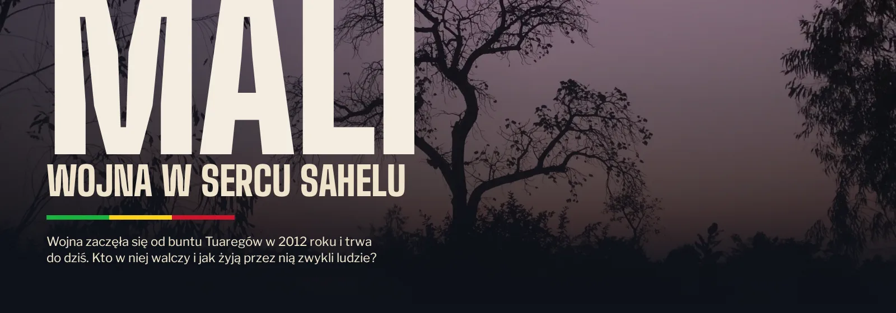
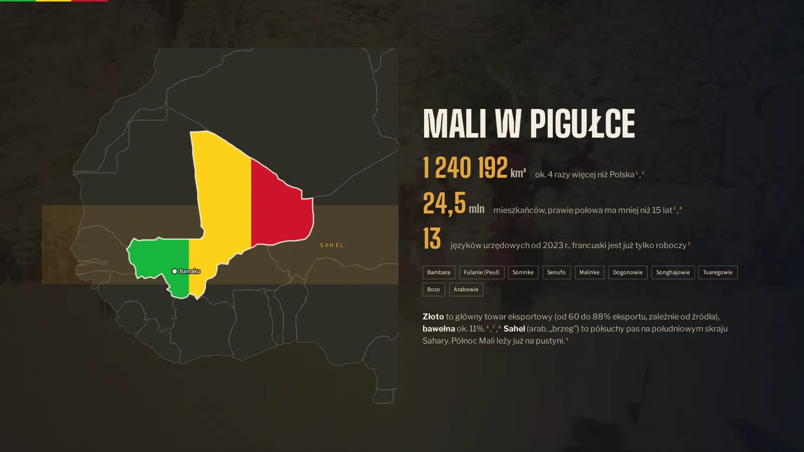
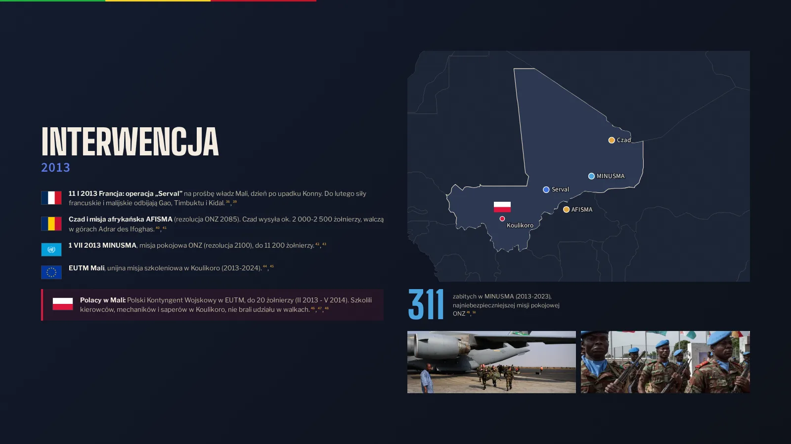
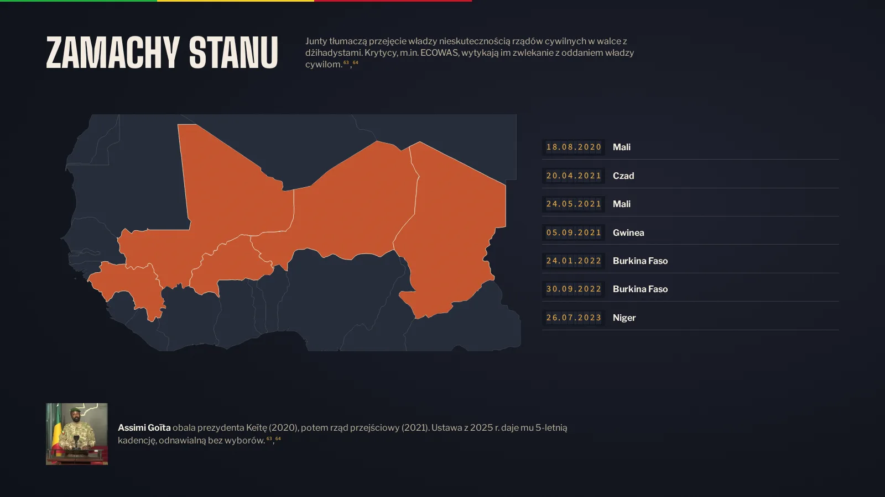
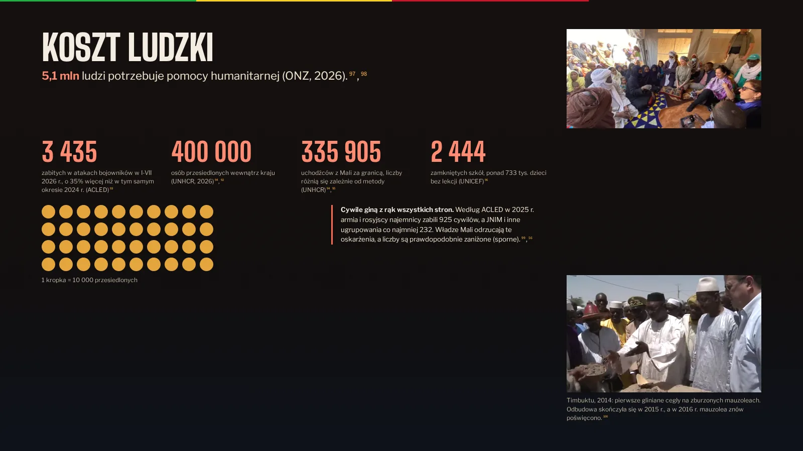
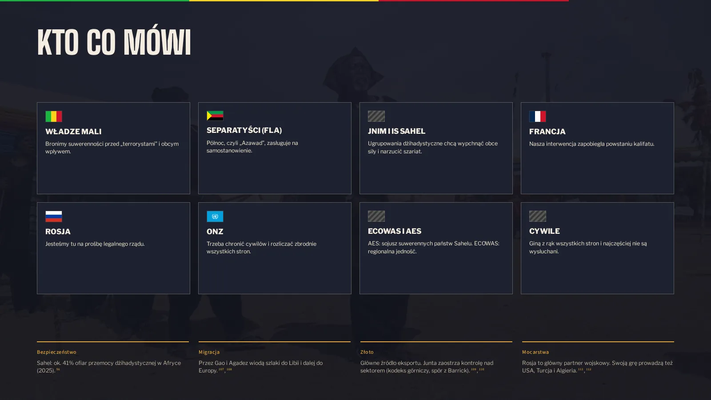
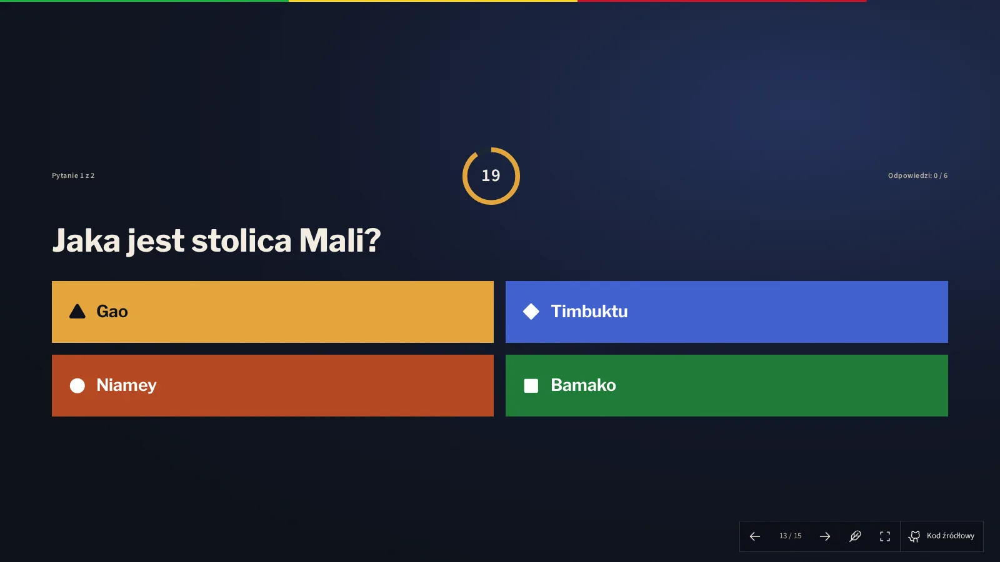
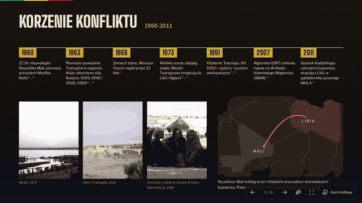
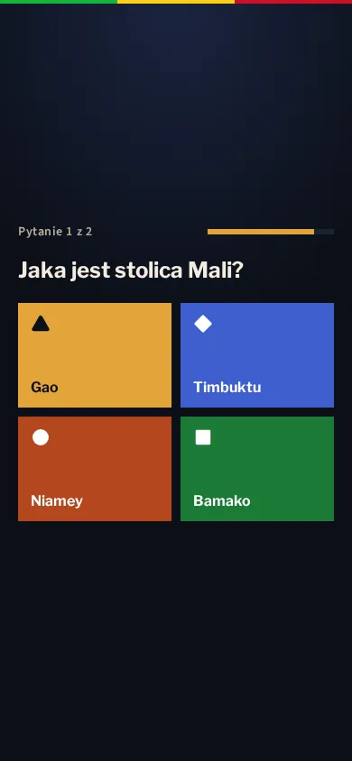

<p align="center">
  
</p>

<h1 align="center">Mali: wojna w sercu Sahelu</h1>

<p align="center">
  Interaktywna prezentacja na lekcję WOS o wojnie w Mali i konflikcie w Sahelu, z quizem na żywo dla całej klasy.
</p>

<p align="center">
  <a href="https://prezentacje.fatum.cc/wos/mali/"></a>
  
  
  
  
</p>

<table>
  <tr>
    <td></td>
    <td></td>
    <td></td>
  </tr>
  <tr>
    <td></td>
    <td></td>
    <td></td>
  </tr>
</table>

<p align="center">
  
  
</p>

## Co w środku

- **15 slajdów** od niepodległości w 1960 r. do października 2026 r., każdy z własną animacją wejścia.
- **Quiz na żywo**: kod QR albo PIN, bez instalowania aplikacji. Wynik liczy serwer. Kolory i kolejność odpowiedzi są takie same na tablicy i na telefonach.
- **Ponad 100 źródeł**: każda liczba ma przypis prowadzący do listy źródeł. Liczby sporne są oznaczone.
- **Działa wszędzie**: tablica interaktywna, stary laptop, telefon. Tryb lekki (klawisz `L`) zachowuje animacje.
- **Zdjęcia, flagi i wideo** na wolnych licencjach (Wikimedia Commons), mapy z Natural Earth.

## Sterowanie

`→` `Spacja` `PageDown` następny slajd · `←` `PageUp` poprzedni · `F` pełny ekran · `L` tryb lekki · przesunięcie palcem lub kliknięcie

## Uruchom lokalnie

```bash
npm install
cp .env.example .env
npm run dev & npm run dev:server
```

Prezentacja: `http://localhost:5173/wos/mali/` · quiz: `http://localhost:5173/wos/mali/quiz/`

Do pracy lokalnej potrzebny jest Node 22.18 lub nowszy (uruchamia pliki `.ts` bezpośrednio). Serwer po zbudowaniu działa na Node 20.6+.

Testy: `npm test` (jednostkowe) i `npm run e2e` (przeglądarka).

---

<p align="center">
  <b>Adam Pietrzak 4D</b><br>
  <sub>Licencja <a href="LICENSE">MIT</a>. Zdjęcia, wideo i flagi: licencje podane na slajdzie „Źródła”.</sub>
</p>
